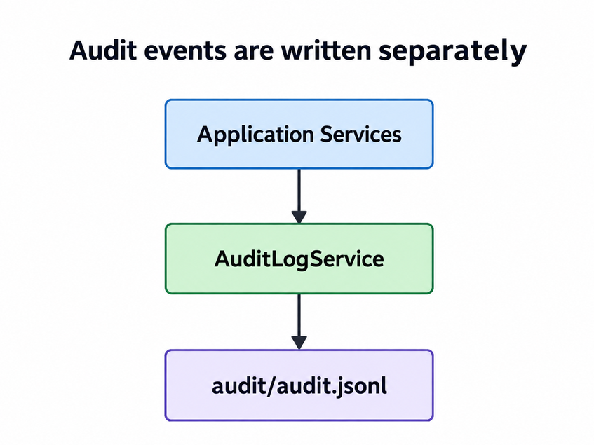
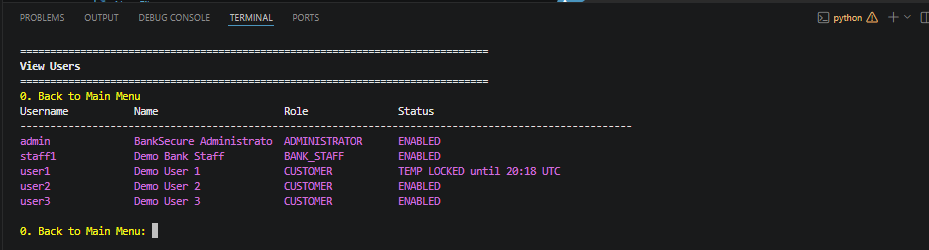
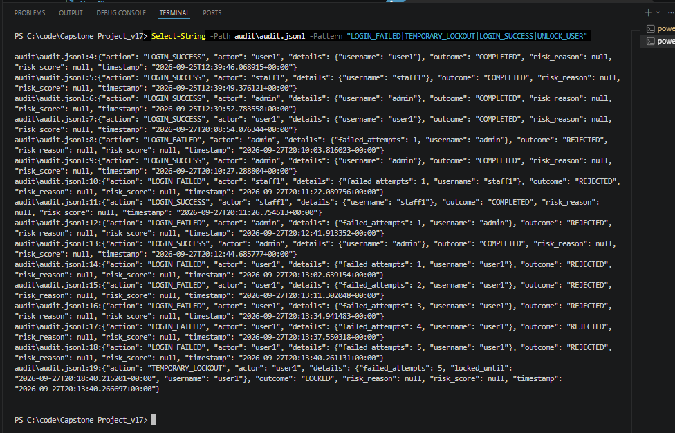
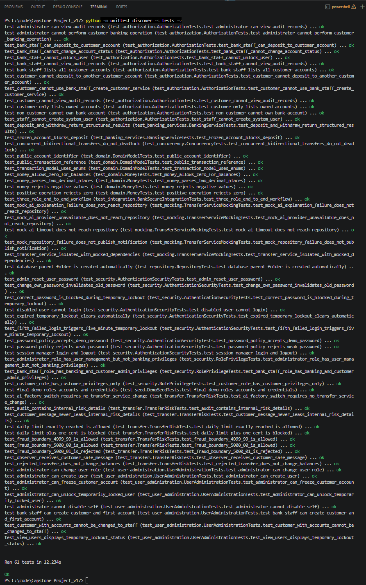
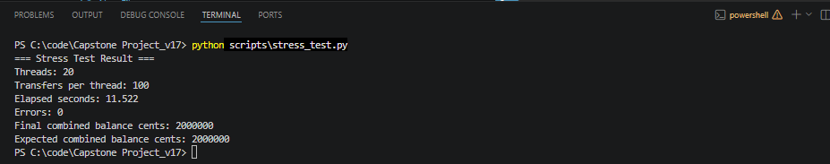
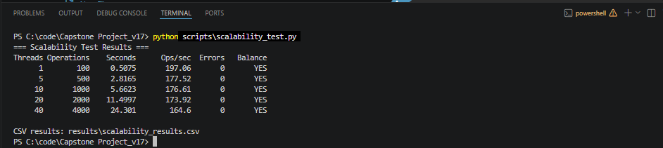

# BankSecure Banking System

BankSecure is an educational banking application developed to demonstrate
advanced object-oriented design, secure coding, role-based access control,
privilege separation, transaction processing, audit logging, design patterns,
SQLite persistence, concurrency controls, testing and AI-ready extensibility.

The project is intended for academic demonstration and is not a production
banking platform.

## Project Goals

BankSecure was designed to demonstrate how a banking application can separate
business responsibilities while keeping security controls inside the service
layer rather than relying only on menu visibility.

The project focuses on:

- Object-oriented design and clear separation of responsibilities
- Role-Based Access Control with separate roles and privileges
- Secure password storage and account-status controls
- Safe handling of monetary values
- Atomic database operations and rollback behaviour
- Concurrent transfer protection
- Fraud and risk assessment through Strategy and Abstract Factory patterns
- Audit logging through the Decorator pattern
- Reporting through the Visitor pattern
- Dependency Injection and a central Composition Root
- Unit, integration, mocking, stress and scalability testing
- Performance benchmarking with CSV evidence
- AI-ready fraud-service extensibility

## Run the Application

From the project directory:

```bash
python main.py
```

The database is stored at:

```text
db/banksecure.db
```

The audit log is stored at:

```text
audit/audit.jsonl
```

The `db` directory is created automatically if it does not already exist.

## Demo Login Accounts

| Username | Password | Role |
|---|---|---|
| `admin` | `P@ssw0rdQTR!@#` | ADMINISTRATOR |
| `staff1` | `StaffQWE!@#` | BANK_STAFF |
| `user1` | `qweQWE!@#` | CUSTOMER |
| `user2` | `qweQWE!@#` | CUSTOMER |
| `user3` | `qweQWE!@#` | CUSTOMER |

`admin` and `staff1` do not own personal bank accounts.

The CUSTOMER demo users have CURRENT, SAVINGS and SALARY accounts with
reproducible demo balances and transaction activity.

## Project Structure

```text
BankSecure-Capstone/
|
|-- main.py
|-- README.md
|
|-- db/
|   `-- banksecure.db
|
|-- audit/
|   |-- README.md
|   `-- audit.jsonl
|
|-- banking/
|   |-- README.md
|   |
|   |-- app/
|   |   |-- container.py
|   |   `-- seeder.py
|   |
|   |-- domain/
|   |   |-- models.py
|   |   |-- money.py
|   |   |-- account_identifier.py
|   |   `-- transaction_identifier.py
|   |
|   |-- patterns/
|   |   |-- decorators.py
|   |   `-- visitors.py
|   |
|   |-- repositories/
|   |   |-- interfaces.py
|   |   `-- sqlite_repository.py
|   |
|   |-- security/
|   |   |-- roles.py
|   |   |-- privileges.py
|   |   |-- session.py
|   |   |-- password_policy.py
|   |   `-- pin_hasher.py
|   |
|   |-- services/
|   |   |-- account_service.py
|   |   |-- ai_fraud.py
|   |   |-- audit_details.py
|   |   |-- audit_service.py
|   |   |-- authorization.py
|   |   |-- banking_operations.py
|   |   |-- bank_staff_service.py
|   |   |-- customer_service.py
|   |   |-- fraud.py
|   |   |-- notifications.py
|   |   |-- profile_service.py
|   |   |-- results.py
|   |   |-- transfer_policy.py
|   |   |-- transfer_service.py
|   |   `-- user_admin_service.py
|   |
|   |-- ui/
|   |   |-- application.py
|   |   |-- console.py
|   |   |-- navigation.py
|   |   `-- handlers/
|   |       |-- account.py
|   |       |-- administrator.py
|   |       |-- bank_staff.py
|   |       |-- base.py
|   |       |-- profile.py
|   |       `-- transfer.py
|   |
|   `-- validation/
|       |-- account_validator.py
|       `-- customer_validator.py
|
|-- scripts/
|   |-- scalability_test.py
|   `-- stress_test.py
|
|-- results/
|   `-- scalability_results.csv
|
|-- images/
|   |-- Administrator_CLI.png
|   |-- Customer_CLI.png
|   |-- Staff_CLI.png
|   |-- full_tests.png
|   |-- stress_test.png
|   |-- scalability_results.png
|   |-- lockout_check.png
|   |-- lockout_database_check.png
|   `-- lockout_audit_logs_check.png
|
`-- tests/
    |-- README.md
    |-- base_test_case.py
    |-- test_domain.py
    |-- test_security.py
    |-- test_authorization.py
    |-- test_user_administration.py
    |-- test_banking_services.py
    |-- test_repository.py
    |-- test_transfer.py
    |-- test_concurrency.py
    |-- test_seed.py
    |-- test_mocking.py
    `-- test_integration.py
```

## System Architecture


The high-level flow is:


Audit events Architecture:




## Presentation Layer

The terminal presentation layer contains:

```text
BankingCLI
Console
AccountCommandHandler
TransferCommandHandler
BankStaffCommandHandler
AdministratorCommandHandler
ProfileCommandHandler
```

`BankingCLI` displays a different menu for each role and routes the selected
command to the appropriate handler.

The UI is not treated as the security boundary. Permissions are checked again
inside the service layer.

## Security Layer

The security layer separates roles, privileges, session state and authorization.

Roles are defined in:

```text
banking/security/roles.py
```

Privileges and their role mapping are defined in:

```text
banking/security/privileges.py
```

Session state is managed in:

```text
banking/security/session.py
```

Authorization logic is implemented in:

```text
banking/services/authorization.py
```

This separation allows BankSecure to answer two different security questions:

```text
What is this user allowed to do?
```

and:

```text
Which resources is this user allowed to access?
```

## Service Layer

Important application services include:

| Service | Responsibility |
|---|---|
| `CustomerService` | Identity registration, authentication and password handling |
| `ProfileService` | Self-service password changes |
| `BankStaffService` | Customer and customer-account creation workflows |
| `UserAdministrationService` | User status, role assignment, password reset and audit access |
| `BankingOperationsService` | Privilege-aware facade for banking operations |
| `AccountService` | Account operations and validation |
| `TransferService` | Transfer coordination, locking, policy and fraud checks |
| `AuthorizationService` | Privilege checks and resource access scope |
| `AuditLogService` | Structured audit event persistence |

`BankStaffService` and `UserAdministrationService` are intentionally separate.
Customer banking administration and system-user administration are different
responsibilities.

## Persistence Layer

The persistence contract is defined by:

```text
banking/repositories/interfaces.py
```

The SQLite implementation is:

```text
banking/repositories/sqlite_repository.py
```

The database file is:

```text
db/banksecure.db
```

The repository creates the database parent directory automatically.

SQLite money values are stored as integer cents rather than floating-point
numbers.

## Database Design

The main SQLite tables are:

| Table | Purpose |
|---|---|
| `customers` | Stores authenticated identities, roles, enabled status and password hashes |
| `accounts` | Stores CUSTOMER-owned bank accounts, balances and account status |
| `transactions` | Stores opening balances, deposits, withdrawals and transfers |

Important identity fields include:

```text
username
full_name
email
role
enabled
failed_login_attempts
locked_until
pin_salt_hex
pin_hash_hex
```

Important account fields include:

```text
customer_id
account_type
balance_cents
status
created_at
```

Important transaction fields include:

```text
transaction_type
from_account_id
to_account_id
amount_cents
status
description
created_at
```

## Domain Model

The central domain classes are:

```text
Customer
Account
Transaction
Money
```

`Money` is a Value Object used to avoid floating-point errors in financial
calculations.

Account status is represented by:

```text
ACTIVE
FROZEN
CLOSED
```

Transaction type is represented by an Enum rather than repeated strings.

Public identifiers are formatted separately from internal database IDs.

Account example:

```text
QTR00000001
```

Transaction reference example:

```text
TXN00000001
```

## Roles and Privileges

BankSecure uses Role-Based Access Control with separate role and privilege
definitions.

The available roles are:

```text
CUSTOMER
BANK_STAFF
ADMINISTRATOR
```

A role identifies the users business function.

A privilege identifies one individual action that the user is allowed to
perform.

Application services request a specific privilege rather than relying only on a
role check.

Example:

```python
authorization_service.require_privilege(
    actor,
    Privilege.RESET_USER_PASSWORD,
)
```

## Role Privilege Matrix

| Capability | CUSTOMER | BANK_STAFF | ADMINISTRATOR |
|---|:---:|:---:|:---:|
| View account details | Yes | Yes | No |
| View balances | Yes | Yes | No |
| Deposit | Yes | Yes | No |
| Withdraw | Yes | Yes | No |
| Transfer | Yes | Yes | No |
| Transaction history | Yes | Yes | No |
| Summary report | Yes | Yes | No |
| Change own password | Yes | Yes | Yes |
| Create customer + first account | No | Yes | No |
| Add customer account | No | Yes | No |
| Create system user | No | No | Yes |
| View users | No | No | Yes |
| Enable or disable users | No | No | Yes |
| Unlock temporary login lockout | No | No | Yes |
| Assign or change role | No | No | Yes |
| Reset user password | No | No | Yes |
| View audit | No | No | Yes |
| Manage account status | No | No | Yes |

## Role 1 - Customer / Client

CUSTOMER privileges include:

- View account details
- View account balances
- Deposit funds
- Withdraw funds
- Transfer funds
- View transaction history
- View account summary
- Change own password


**Customer CLI**


## Role 2 - Bank Staff

BANK_STAFF privileges include:

- Create customer + first account
- Add account to an existing customer
- View customer account details
- View customer account balances
- Deposit to customer accounts
- Withdraw from customer accounts
- Transfer between customer accounts
- View account history
- View bank summary
- Change own password


BANK_STAFF can operate on CUSTOMER accounts across the bank but cannot create
system administrators, change user roles, reset user passwords, enable or
disable users or view administrator audit records.

**Bank Staff CLI**


## Role 3 - Administrator

ADMINISTRATOR privileges include:

- Create system user
- View users
- Enable user
- Disable user
- Unlock temporarily locked user
- Assign or change user role
- Reset user password
- View audit records
- Manage customer account status
- Change own password

The ADMINISTRATOR role intentionally does not receive normal deposit,
withdrawal or transfer privileges.

**Administrator CLI Evidence**


## Resource Scope

A privilege does not automatically provide access to every bank account.

CUSTOMER example:

```text
Privilege: TRANSFER_FUNDS
Scope: Own source accounts only
```

BANK_STAFF example:

```text
Privilege: TRANSFER_FUNDS
Scope: CUSTOMER accounts across the bank
```

ADMINISTRATOR example:

```text
No TRANSFER_FUNDS privilege
```

This separates action permission from resource access.

## User Enable, Disable and Temporary Login Lockout

Every user record has an administrative `enabled` status and separate
authentication lockout state.


```text
enabled = False
-> Administratively disabled until an ADMINISTRATOR enables the user

enabled = True + locked_until in the future
-> Temporarily locked because of failed login attempts
```

After five consecutive failed password attempts, BankSecure applies a
five-minute temporary lockout. During the lockout, even the correct password is
rejected.

When the five minutes expire, the temporary lock automatically clears on the
next authentication attempt. An ADMINISTRATOR can also clear the temporary
lockout early through `Unlock Temporarily Locked User`.

The `View Users` screen displays the effective user state, including:

```text
ENABLED
DISABLED
TEMP LOCKED until HH:MM UTC
DISABLED / TEMP LOCKED until HH:MM UTC
```

This makes the reason for access denial visible to the administrator without
mixing temporary authentication lockouts with administrative disablement.

The active ADMINISTRATOR cannot disable their own account from the current
session.

**Temporary Lockout Evidence**



**Database Lockout Evidence**


## Role Change Control

An ADMINISTRATOR can assign or change another users role.

A CUSTOMER that already owns bank accounts cannot be changed directly to
BANK_STAFF or ADMINISTRATOR.

This protects the relationship between a banking customer identity and the
accounts owned by that identity.

## Bank Account Ownership

Only users with role `CUSTOMER` can own bank accounts.

BANK_STAFF and ADMINISTRATOR identities are system users and do not receive
personal banking accounts.

## Password and Authentication Security

All three roles can change their own password.

The ADMINISTRATOR can also reset another users password.

Password rules include:

- Minimum 9 characters
- At least one uppercase character
- At least one lowercase character
- At least one special character
- No whitespace
- Password must not contain the username

Passwords are stored using PBKDF2-HMAC-SHA256 with an independent random salt.

Plain-text passwords are never stored in the SQLite database or the audit log.

Authentication is handled by `CustomerService`, while authenticated session
state is held by `SessionManager`.

The authentication workflow also tracks `failed_login_attempts` and
`locked_until`. Successful authentication resets the failed-attempt counter.
A valid password is not sufficient to authenticate either a disabled user or a
user with an active temporary lockout.

Authentication security events are written to the audit log, including failed
logins, temporary lockouts, automatic lockout expiry, successful logins and
administrator-triggered unlocks.

## Account Status

Customer bank accounts support:

```text
ACTIVE
FROZEN
CLOSED
```

Only ACTIVE accounts can perform money-moving operations.

Account status management is available to ADMINISTRATOR through
`Administration & Audit`.

## Authorization Model

BankSecure separates three security questions.

**Privilege check**

```text
Is this role allowed to perform this type of action?
```

**Resource access check**

```text
Which bank accounts may this user access?
```

**Business and risk checks**

```text
Is the requested transaction permitted by banking policy and fraud controls?
```

This means hiding a menu option is not the security control. The service layer
performs the authorization check again.

## Transfer Controls

A transfer passes through:

```text
Authentication
    ->
Privilege check
    ->
Source account access check
    ->
Destination validation
    ->
Daily transfer policy
    ->
Fraud / risk strategy
    ->
Deterministic account locking
    ->
SQLite transaction
    ->
Audit logging
    ->
Customer-safe result
```

Detailed fraud scores and provider explanations are not displayed to the
CUSTOMER.

They are retained internally in the structured audit record for authorized
administrative review.


## Rejected Transfer Behaviour

The fraud strategy can reject a transfer before SQLite balances are changed.

The `AuditedTransferService` records the internal risk score and explanation,
while the normal customer-facing output contains only a generic
security-rejection message.

A rejected transfer therefore does not partially update account balances.

## Daily Transfer Policy

The daily transfer limit is implemented as a business policy rather than as
part of the fraud strategy.

This keeps business rules and fraud assessment separate.

The transfer service checks the amount already transferred from the source
account since the start of the current UTC day before committing the new
transfer.

## Concurrency and Atomicity

Transfers acquire account locks in deterministic account-ID order.

This reduces the risk of deadlock during opposite-direction concurrent
transfers.

The SQLite repository also uses explicit transaction handling with:

```text
BEGIN IMMEDIATE
COMMIT
ROLLBACK
```

The repository transaction context manager ensures that failed financial
operations are rolled back rather than partially committed.

## Audit Logging

The structured audit log is stored in:

```text
audit/audit.jsonl
```

The format is JSON Lines, where each line represents one independent event.

Audit events include:

- Financial operations
- User creation
- Customer creation
- Role changes
- User enable and disable actions
- Failed login and temporary authentication lockout events
- Administrator temporary unlock actions
- Administrator password resets
- Self-service password changes
- Customer account status changes
- Fraud and risk details for transfer decisions

Passwords are never written to the audit log.

Operational data and audit data are intentionally separated:

```text
Operational Data
    ->
db/banksecure.db

Security Audit Events
    ->
audit/audit.jsonl
```

**Audit Log Evidence**



## Design Patterns

The project demonstrates several design patterns with defined responsibilities.

| Pattern | Project Use |
|---|---|
| Strategy | Swappable fraud detection behaviour |
| Abstract Factory | Creates matching fraud strategy and risk-explanation families |
| Decorator | Adds transfer auditing without changing the core transfer service |
| Observer | Receives customer-safe transfer notifications |
| Visitor | Produces account and bank summary reports from domain objects |
| Repository | Separates persistence contracts from SQLite implementation |
| Dependency Injection / IoC | Dependencies are constructed centrally and injected into services |

The patterns are used for specific design purposes rather than added only to
increase the number of patterns.

## Visitor Pattern

The Visitor pattern is implemented in:

```text
banking/patterns/visitors.py
```

`PortfolioSummaryVisitor` visits both `Account` and `Transaction` domain
objects.

For accounts it collects values such as:

```text
account count
total balance
```

For transactions it collects values such as:

```text
transaction count
transaction type totals
```

The domain objects expose `accept()` methods while the reporting logic remains
outside the domain classes.

This keeps summary and analytics behaviour separate from the main Account and
Transaction responsibilities.

The Visitor is used by:

```text
Account Summary Report
Bank Summary Report
```

## Decorator Pattern

The Decorator pattern is implemented by `AuditedTransferService`.

The core `TransferService` performs transfer coordination.

`AuditedTransferService` wraps that behaviour and records completed, rejected
and failed transfer events without embedding audit persistence directly inside
the core transfer service.

## Strategy Pattern

`TransferService` depends on a `FraudDetectionStrategy` abstraction.

The current project can use:

```text
RuleBasedFraudStrategy
SimulatedAIFraudStrategy
```

This allows fraud behaviour to change without changing the transfer
orchestration.

## Abstract Factory Pattern

The security family is created through a `SecurityServiceFactory`.

The local family is created by:

```text
LocalSecurityFactory
```

which provides:

```text
RuleBasedFraudStrategy
LocalRiskExplanationService
```

The simulated AI family is created by:

```text
SimulatedAISecurityFactory
```

which provides:

```text
SimulatedAIFraudStrategy
AILikeRiskExplanationService
```

The same `TransferService` works with either family.

## Observer Pattern

Transfer observers receive customer-safe notification text after a successful
transfer.

Internal fraud scores, provider names and risk explanations are not included in
observer messages intended for normal customer output.

## Repository Pattern

`BankRepository` defines the persistence contract.

`SQLiteBankRepository` implements that contract using SQLite.

Application services depend on the repository abstraction rather than writing
SQL directly.

## Dependency Injection and IoC

`ApplicationContainer` is the Composition Root.

It creates concrete dependencies and injects them into the services that need
them.

This centralizes application wiring and avoids creating infrastructure objects
inside business services.

## AI-Ready Fraud Integration

The project includes a deterministic `SimulatedAIFraudStrategy` to demonstrate
how an external model or provider could be integrated without coupling the
banking workflow to one implementation.

AI-related fraud logic is kept in:

```text
banking/services/ai_fraud.py
```

## AI Abstractions

`TransferService` depends on:

- `FraudDetectionStrategy`
- `RiskExplanationService`

These dependencies are supplied through the application Composition Root.

This keeps `TransferService` independent from one concrete risk provider.

## Local Security Family

`LocalSecurityFactory` creates:

- `RuleBasedFraudStrategy`
- `LocalRiskExplanationService`

## Simulated AI Security Family

`SimulatedAISecurityFactory` creates:

- `SimulatedAIFraudStrategy`
- `AILikeRiskExplanationService`

The same `TransferService` works with either security family without
modification.

## Future AI Extension

A future implementation could add classes such as:

```text
RealMLFraudStrategy
RealAIRiskExplanationService
RealAISecurityFactory
```

The transfer workflow would remain unchanged because it depends on abstractions
rather than a specific model.

## AI Risk Information Handling

Normal customers do not receive provider names, model-like scores or internal
risk explanations.

Detailed risk information is retained in the structured audit log and can be
reviewed through ADMINISTRATOR audit functions.

This demonstrates separation between customer-facing output and internal
security evidence.

## Mocking and Dependency Isolation

The project uses Python's built-in `unittest.mock` framework to test important
components without requiring SQLite or a live AI/model provider.

The mocking tests are implemented in:

```text
tests/test_mocking.py
```

`TransferService` is constructed with mocked versions of:

```text
BankRepository
TransferPolicy
FraudDetectionStrategy
RiskExplanationService
NotificationObserver
```

This verifies that the service depends on abstractions and can be tested in
isolation.

The mocked repository test confirms that a transfer can be exercised without a
real SQLite database and that the expected `Money`, account IDs and description
are passed to the repository correctly.

## Mock AI Failure Testing

Mocked AI/provider failures are used to test failure paths without connecting to
a real model or external API.

The tests currently simulate:

- AI/provider timeout
- AI/provider unavailable
- Risk-explanation failure

For each simulated provider failure, the tests verify that:

```text
repository.transfer() is not called
observer.update() is not called
```

This is important because risk assessment occurs before the financial database
operation. A provider failure therefore cannot partially debit or credit an
account through `TransferService`.

A separate mocked repository failure test verifies that notifications are not
published when persistence fails.

## Testing

The 61 tests are organised by responsibility instead of being collected in one
large test module. This makes each test file easier to review and directly links
the evidence to the component or security responsibility being tested.

Run the full test suite with:

```bash
python -m unittest discover -s tests -v
```

The current verified suite contains **61 passing tests**.

| Test Module | Responsibility | Tests |
|---|---|---:|
| `test_domain.py` | Money, public identifiers and transaction-domain behaviour | 7 |
| `test_security.py` | Roles, privileges, authentication, sessions, password policy and temporary lockout | 12 |
| `test_authorization.py` | RBAC boundaries, account scope, audit access and unlock authorization | 13 |
| `test_user_administration.py` | Customer creation, system users, roles, account administration, unlock and View Users status | 8 |
| `test_banking_services.py` | Banking result objects and frozen-account behaviour | 2 |
| `test_repository.py` | SQLite repository and database-path creation | 1 |
| `test_transfer.py` | Fraud, policy, audit, Observer, AI factory and rollback behaviour | 10 |
| `test_concurrency.py` | Concurrent bidirectional transfers and deadlock prevention | 1 |
| `test_seed.py` | Demo users, roles, credentials and seeded account types | 1 |
| `test_mocking.py` | Mock repository, dependency isolation and AI/provider failures | 5 |
| `test_integration.py` | Complete three-role end-to-end workflow | 1 |
| **Total** |  | **61** |

`base_test_case.py` contains only the shared real-application fixture used by
several unit-test groups. It creates a temporary SQLite database, audit file,
users and accounts for each test case; it does not contain any test method.

Main test areas include:

- Money Value Object behaviour
- Separate role and privilege definitions
- CUSTOMER privileges
- BANK_STAFF privileges
- ADMINISTRATOR privileges
- CUSTOMER account ownership boundaries
- BANK_STAFF cross-customer banking access
- ADMINISTRATOR banking-operation denial
- User creation
- User enable and disable
- Disabled-user login prevention
- Five-attempt temporary login lockout
- Correct-password denial during active lockout
- Automatic lockout expiry after five minutes
- Administrator early unlock
- Temporary-lock status shown in View Users
- Role changes
- Password self-service changes
- Administrator password reset
- Customer and account creation
- Account-status management
- Fraud thresholds
- Daily transfer limits
- AI strategy switching
- Mocked AI/provider timeout and availability failures
- Mocked risk-explanation failure
- Mocked repository isolation
- Notification suppression after persistence failure
- Risk-information confidentiality
- Structured audit records
- Public account and transaction references
- Rollback behaviour
- Concurrent transfers
- Seeded role and account data
- End-to-end three-role workflow

**Automated Test Evidence**



## Stress and Concurrency Testing

Run the stress test with:

```bash
python scripts/stress_test.py
```

The current stress test uses:

```text
Threads: 20
Transfers per thread: 100
```

The test validates:

- Concurrent opposite-direction transfers
- No unhandled transfer errors
- No deadlock during the test run
- Conservation of the combined balance


**Stress Test**



## Scalability Testing and Performance CSV

A separate multi-level scalability benchmark is provided in:

```text
scripts/scalability_test.py
```

Run it with:

```bash
python scripts/scalability_test.py
```

The benchmark runs the same transfer workload at increasing concurrency levels:

```text
1 thread
5 threads
10 threads
20 threads
40 threads
```

Each thread performs:

```text
100 transfers
```

For every level, the script records:

- Thread count
- Transfers per thread
- Total operations
- Elapsed time
- Operations per second
- Error count
- Final combined balance
- Expected combined balance
- Whether balance conservation passed

The results are automatically written to:

```text
results/scalability_results.csv
```

The latest verified benchmark produced:

| Threads | Operations | Seconds | Operations/sec | Errors | Balance Conserved |
|---:|---:|---:|---:|---:|:---:|
| 1 | 100 | 0.5075 | 197.06 | 0 | YES |
| 5 | 500 | 2.8165 | 177.52 | 0 | YES |
| 10 | 1000 | 5.6623 | 176.61 | 0 | YES |
| 20 | 2000 | 11.4997 | 173.92 | 0 | YES |
| 40 | 4000 | 24.3010 | 164.60 | 0 | YES |

The benchmark is intended as evidence of how the current SQLite and locking
design behaves as concurrent workload increases. The throughput reduction at
higher thread counts is expected to be discussed as a design limitation of a
single-process SQLite-based educational system rather than presented as
production-scale performance.

**Scalability Test Evidence**



## Security Design Decisions

Several design choices are intentionally security-focused.

**Authorization is enforced in services**

The program does not depend only on the menu to block restricted actions.

**Roles and privileges are separate**

A role describes a user type, while a privilege describes an allowed action.

**Resource access is checked separately**

A CUSTOMER and BANK_STAFF may both have a banking privilege, but their account
scope is different.

**Administrator banking privileges are restricted**

The ADMINISTRATOR is responsible for user administration and audit rather than
normal customer banking operations.

**Passwords are hashed**

Passwords are not stored in plain text.

**Disabled users cannot authenticate**

A correct password does not bypass the enabled-status control.

**Repeated failed logins trigger a temporary lockout**

Five consecutive failed password attempts create a five-minute temporary
lockout. The temporary state is stored separately from the administrator's
`enabled` control, expires automatically and can be cleared early only by an
authorized ADMINISTRATOR.

**Money uses integer cents**

This avoids floating-point precision problems.

**Transfers are atomic**

SQLite transaction handling protects financial consistency.

**Concurrent transfers use deterministic locking**

Account locks are acquired in sorted account-ID order.

**Fraud details are not exposed to normal customers**

Internal scores and explanations remain available to authorized audit
functions.

**Audit and operational data are separated**

Business data is stored in SQLite while security audit events are kept in the
JSONL audit log.

## Current Scope and Limitations

BankSecure is an educational system.

It does not provide:

- Production-grade online banking infrastructure
- Real payment-network integration
- Real multi-factor authentication
- Real machine-learning fraud detection
- Distributed transaction processing
- High-availability database clustering
- Production SIEM integration
- Production secrets management

The simulated AI strategy is intentionally deterministic and exists only to
demonstrate extensible architecture.

## Future Improvements

Possible future extensions include:

- Real external fraud-model integration through the existing Strategy and
  Abstract Factory abstractions
- Multi-factor authentication
- Password-expiry and account-lockout policies
- Persistent audit storage in a dedicated logging platform
- Database migration tooling
- Additional account products
- More advanced transaction rules
- API or web presentation layer
- Extended reporting visitors
- Production-grade monitoring and observability

These improvements can be introduced without changing the core separation
between presentation, authorization, business services and persistence.
