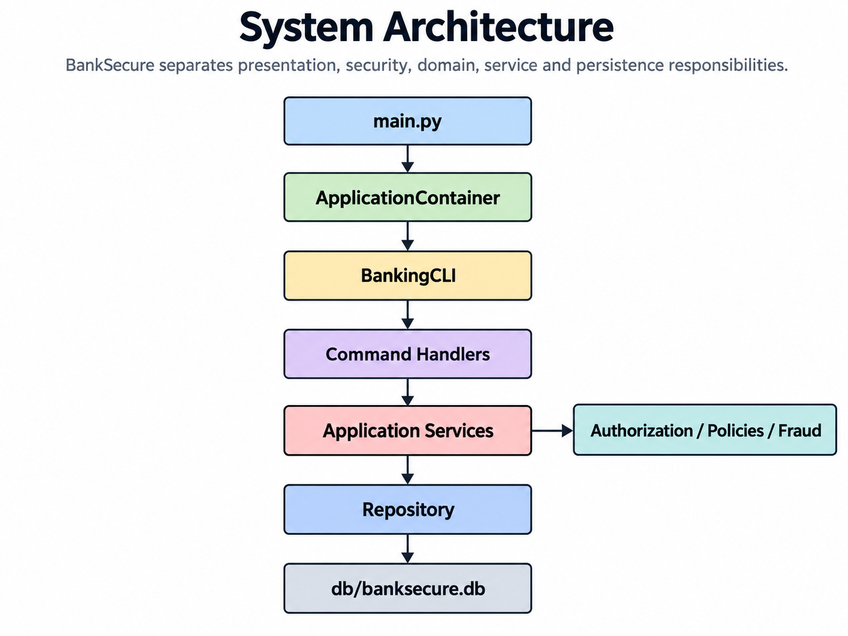
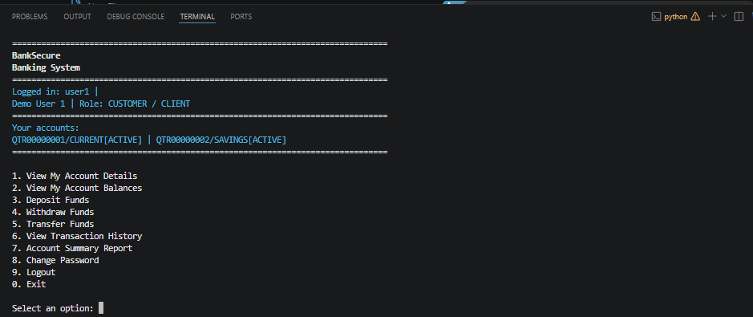
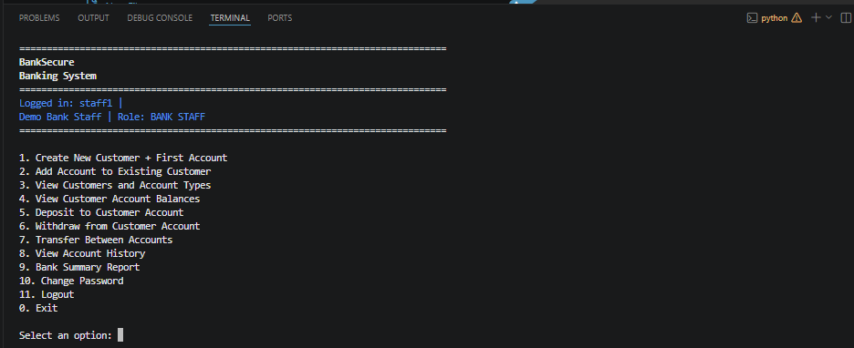
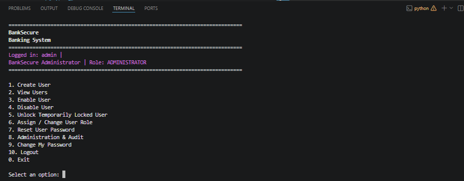
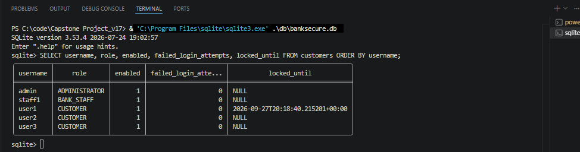

# Banking Package

The `banking` package contains the main BankSecure application code.

It is organised by responsibility so that domain objects, security controls,
business services, persistence and presentation logic remain separated.


## High-Level Execution Flow

The high-level flow is:



## app

`app/container.py`

The Composition Root.

It creates concrete dependencies and injects them into the services that need
them.

This is the central Dependency Injection / Inversion of Control point.

`app/seeder.py`

Creates the reproducible demonstration users, roles, accounts and initial
transaction activity.

## domain

`domain/models.py`

Contains the main domain models and enums:

```text
Customer
Account
Transaction
AccountStatus
TransactionType
TransactionStatus
```

The `Customer` model also contains authentication state such as:

```text
enabled
failed_login_attempts
locked_until
```

`domain/money.py`

Implements the `Money` Value Object.

Financial values are represented using integer cents instead of floating-point
amounts.

`domain/account_identifier.py`

Formats and parses public account references such as:

```text
QTR00000001
```

`domain/transaction_identifier.py`

Formats public transaction references such as:

```text
TXN00000001
```

## security

`security/roles.py`

Defines:

```text
CUSTOMER
BANK_STAFF
ADMINISTRATOR
```

`security/privileges.py`

Defines individual privileges and maps them to roles.

This includes the Administrator-only privilege:

```text
UNLOCK_USER
```

`security/session.py`

Maintains the authenticated user session.

`security/password_policy.py`

Applies password-strength requirements.

`security/pin_hasher.py`

Stores passwords using PBKDF2-HMAC-SHA256 with a random salt.

## services

`services/customer_service.py`

Handles:

- User registration
- Authentication
- Failed-login counters
- Five-minute temporary login lockout
- Automatic lockout expiry
- Password management
- User enable state

`services/authorization.py`

Checks both:

```text
What action is the user allowed to perform?
```

and:

```text
Which accounts/resources can the user access?
```

`services/banking_operations.py`

Provides the privilege-aware banking operations used by the UI.

`services/account_service.py`

Handles account creation, deposits, withdrawals, history and account status
behaviour.

`services/transfer_service.py`

Coordinates the transfer workflow including:

- Money validation
- Deterministic account locking
- Daily transfer policy
- Fraud assessment
- Repository transaction
- Notification

`services/transfer_policy.py`

Contains the daily outgoing-transfer rule.

`services/fraud.py`

Contains the fraud Strategy abstraction, local rule-based implementation and
security Abstract Factory contracts.

`services/ai_fraud.py`

Contains the deterministic simulated AI fraud family used to demonstrate
AI-ready extensibility without requiring a live external model.

`services/audit_service.py`

Writes and reads JSONL audit events.

`services/audit_details.py`

Contains typed audit-detail objects.

`services/bank_staff_service.py`

Contains BANK_STAFF-only customer and account administration.

`services/user_admin_service.py`

Contains ADMINISTRATOR-only system-user management such as:

- Create user
- Enable user
- Disable user
- Unlock temporarily locked user
- Change role
- Reset password
- Review audit
- Change account status

`services/profile_service.py`

Handles self-service password changes.

`services/notifications.py`

Contains the Observer Pattern used for transfer notifications.

`services/results.py`

Contains structured result objects returned by service operations.

## repositories

`repositories/interfaces.py`

Defines the `BankRepository` persistence abstraction.

`repositories/sqlite_repository.py`

Implements the repository using SQLite.

It contains:

- User persistence
- Account persistence
- Transaction persistence
- Failed-login and lockout persistence
- Explicit transaction handling
- Commit and rollback behaviour

The main database is:

```text
db/banksecure.db
```

## patterns

`patterns/decorators.py`

Implements the Decorator Pattern through transfer auditing.

`patterns/visitors.py`

Implements the Visitor Pattern used by account and bank summary reporting.

The project also demonstrates Strategy, Abstract Factory, Observer, Repository
and Dependency Injection / IoC.

## ui

`ui/application.py`

Controls login and selects the correct menu for the authenticated role.

`ui/console.py`

Handles terminal output, colours, prompts and screen presentation.

`ui/navigation.py`

Contains navigation helpers.

`ui/handlers/`

Contains role and workflow-specific command handlers:

```text
account.py
transfer.py
bank_staff.py
administrator.py
profile.py
base.py
```

The UI is not treated as the security boundary.

Restricted actions are checked again in the service layer.

## CLI Evidence

Customer interface:



Bank Staff interface:



Administrator interface:



## Authentication State Evidence

The following screenshot shows the persisted `failed_login_attempts` and `locked_until` fields used by the temporary login-lockout workflow.



## validation

`validation/customer_validator.py`

Validates user-related input.

`validation/account_validator.py`

Validates account-related input.

## config.py

Contains shared configuration values such as:

- Database and audit paths
- Password configuration
- Failed-login threshold
- Temporary lockout duration
- Fraud threshold
- Daily transfer limit
- Account and transaction identifier settings

## exceptions.py

Contains BankSecure-specific exception classes used to communicate controlled
business, security and persistence failures.

## Important Security Flow

Authentication:

```text
Username
   |
   v
Temporary lock active?
   |
   +--> Yes -> Reject login
   |
   v
Password valid?
   |
   +--> No -> Increment failed attempts
   |             |
   |             `--> Fifth failure -> Lock for 5 minutes
   |
   v
User enabled?
   |
   +--> No -> Reject login
   |
   v
Authenticated session
```

Transfer:

```text
Privilege
   |
Resource access
   |
Daily policy
   |
Fraud assessment
   |
Account locks
   |
SQLite transaction
   |
Audit / notification
```
