# Unit 12 – Recent Developments and Review

**Programme:** MSc Cyber Security  
**Module:** Advanced Object-Oriented Design and Programming  
**Unit:** 12 – Recent Developments and Review  

## Unit Summary

Unit 12 is the final unit of the module and brings together the knowledge and practical skills developed across the previous eleven units. The unit focuses on completing the **Capstone Project**, reviewing the key concepts covered throughout the module, preparing for the final assessment, and presenting the completed work clearly.

The unit consolidates advanced object-oriented design principles, design patterns, secure coding practices, software architecture and testing strategies. It also provides an opportunity to apply these areas together in a complex software system addressing a practical problem in cybersecurity, data science or AI.

My main practical artefact for this unit is the **BankSecure Banking System**, which integrates the key technical and architectural concepts developed throughout the module.

## Learning Outcomes

By the end of this unit, I was able to:

- Design and implement a complex software system using advanced object-oriented design principles, design patterns and secure coding practices.
- Apply module knowledge to a practical cybersecurity-related software problem.
- Review and consolidate the key concepts covered throughout the module.
- Present the Capstone Project and its supporting evidence clearly.
- Critically evaluate the design, testing approach, strengths, limitations and future improvements of the final system.

## Capstone Project – BankSecure Banking System

BankSecure is a Python-based educational banking application developed as the final Capstone Project.

The project demonstrates how advanced object-oriented design can be combined with secure coding, persistence, concurrency controls, role-based access control, audit logging, design patterns and automated testing within one coherent system.

The implementation include:

- CUSTOMER, BANK_STAFF and ADMINISTRATOR roles.
- Role-Based Access Control and resource-level authorisation.
- PBKDF2-based password protection and password policy enforcement.
- Temporary login lockout after repeated failed authentication attempts.
- SQLite persistence for users, accounts and transactions.
- Transaction commit and rollback behaviour.
- Deterministic account locking for concurrent transfers.
- Audit logging for authentication, administration and financial activity.
- Strategy, Abstract Factory, Decorator, Visitor, Observer and Repository patterns.
- Dependency Injection through a central `ApplicationContainer`.
- Mock-based testing of dependencies and simulated AI-provider failures.
- Unit, integration, concurrency, stress and scalability testing.
- AI-ready fraud-service abstractions without depending on a live external model.

Representative implementation evidence from the BankSecure Capstone Project, demonstrating selected design, security, concurrency, testing and architectural concepts across Units 1–12, is provided in the Comprehensive Code Evidence section below.

## Consolidation of Module Concepts

| Module Area | Capstone Application |
|---|---|
| Advanced OOP |Encapsulation, abstractions, composition, polymorphism, SOLID principles and service-oriented class responsibilities |
| Design Patterns | Strategy, Abstract Factory, Decorator, Visitor, Observer and Repository |
| Secure Coding | Password protection, validation, authentication lockout, RBAC and controlled exceptions |
| Software Architecture | Layered responsibilities, Repository abstraction, Dependency Injection and Composition Root |
| Refactoring and Maintainability | Named configuration values and separated business policy logic to improve readability and maintainability |
| Concurrency | Account-specific locks and deterministic lock ordering |
| Persistence | SQLite repository with explicit commit and rollback behaviour |
| Testing | Unit, negative, mocking, integration, concurrency, stress and scalability testing |
| AI-Readiness | Replaceable fraud and explanation services through interfaces and factories |

## Design Patterns in the Capstone

### Strategy Pattern

`FraudDetectionStrategy` allows fraud-assessment behaviour to be changed without rewriting the transfer workflow. This improves runtime flexibility and supports isolated testing (Gamma et al., 1994).

### Abstract Factory Pattern

`SecurityServiceFactory` creates compatible fraud-assessment and risk-explanation components. The design supports switching between local and simulated AI service families without modifying `TransferService` (Gamma et al., 1994).

### Decorator Pattern

Audit behaviour is kept separate from the core transfer workflow. The decorator adds structured transfer-audit records without embedding audit persistence throughout the transfer algorithm (Gamma et al., 1994).

### Visitor Pattern

Reporting behaviour is separated from the main domain objects through `PortfolioSummaryVisitor`, reducing the number of unrelated responsibilities inside `Account` and `Transaction` (Gamma et al., 1994).

### Observer Pattern

Notification behaviour is separated from the transfer workflow through observer implementations that can receive transfer outcomes without changing the core transfer logic (Gamma et al., 1994).

### Design Patterns

Persistence is separated from business services through a repository abstraction, allowing the application to use SQLite without coupling high level services directly to database specific code.

## Security and Robustness

Security controls are enforced within the service layer rather than relying only on the terminal menu.

Important controls include:

- password hashing with a random salt;
- password-strength validation;
- role and privilege separation;
- resource-level account access rules;
- five-failure temporary authentication lockout;
- administrator-only temporary unlock;
- controlled account status management;
- internal audit logging;
- customer-safe error messages;
- negative and failure-path testing.

The separation between administrative disablement and temporary authentication lockout was an important design decision because the two controls have different purposes and lifecycles.

## Concurrency, Persistence and Rollback

Concurrent transfers use account-specific re-entrant locks.

Account IDs are sorted before both locks are acquired, so opposite-direction transfers attempt to acquire the same locks in the same order. This reduces the possibility of circular wait and deadlock within the application process.

The SQLite repository provides persistent storage and explicit transactional behaviour. Successful operations commit, while repository failures trigger rollback so that partially completed financial changes do not remain in the database.

## Testing and Validation

The final project contains **61 automated tests** covering:

- domain behaviour;
- authentication and password controls;
- temporary login lockout;
- RBAC and authorisation;
- user administration;
- banking operations;
- repository behaviour;
- fraud and transfer policies;
- rollback behaviour;
- mocking and dependency isolation;
- concurrency;
- seed data;
- end-to-end integration.

The project also includes dedicated stress and scalability scripts.

The stress workload exercises concurrent transfers and verifies that no errors occur and the combined account balance remains unchanged.

The scalability benchmark increases the number of threads through 1, 5, 10, 20 and 40 threads. The benchmark records elapsed time, throughput, errors and balance conservation. The final results showed zero errors and preserved the expected combined balance at every measured level, while throughput gradually decreased as concurrency increased.

## AI-Ready Design

The project does not claim to use a production machine-learning model.

Instead, AI-readiness is demonstrated through architecture. Fraud assessment and risk explanation depend on abstractions, and a simulated AI service family can be injected without changing the core transfer implementation.

This design makes it possible for a future implementation to introduce a real external or local model while preserving the current service contract and testing approach.

## Critical Review

One of the main lessons from the Capstone was that additional abstraction is useful only when it solves a clear problem.

The design patterns used in BankSecure improve separation of concerns, substitutability and testability, but they also introduce additional classes and interactions. Patterns were therefore applied selectively rather than adding abstraction for its own sake (Gamma et al., 1994; Fowler, 2018).

The project also has clear limitations. SQLite and in-process locks are appropriate for the educational scope but are not equivalent to a distributed production banking architecture (SQLite, n.d.). A production implementation would require stronger identity controls, distributed concurrency management, enterprise database infrastructure, centralised audit storage, operational monitoring and additional resilience controls.

## Reflection

Unit 12 brought together topics that had previously been explored separately.

The Capstone showed me that secure and maintainable software depends on the interaction between design, architecture, validation and testing. A transfer service can be object-oriented and functionally correct while still being unsafe if concurrent access, persistence failure or authorisation boundaries are not considered.

The final project also changed how I evaluate design patterns. I now consider the problem a pattern solves, the dependency it removes or controls, and the testing impact before deciding whether the extra abstraction is justified (Gamma et al., 1994; Fowler, 2018).

Testing became part of the design process rather than only a final verification stage. Mocking helped isolate components, while integration, concurrency, stress and scalability testing showed why isolated unit tests alone are not sufficient evidence of system behaviour.

## Portfolio and Repository Links

| Resource | Link |
|---|---|
| Live MSc e-Portfolio | https://ralemadi.github.io/MSc-Cyber-Security-e-Portfolio/ |
| Advanced OOP Module Page | https://ralemadi.github.io/MSc-Cyber-Security-e-Portfolio/advanced-oop.html |
| GitHub Repository | https://github.com/Ralemadi/MSc-Cyber-Security-e-Portfolio |
| Capstone Project | https://github.com/Ralemadi/MSc-Cyber-Security-e-Portfolio/unit-12/Capstone%20Project |

## Comprehensive Code Evidence

This section presents selected examples of Advanced OOP concepts and techniques learned across the module units and applied in the BankSecure Capstone Project. The evidence is intended to demonstrate a range of practical skills rather than reproduce the complete implementation.

***1-	Encapsulation and Validation (Unit 1)***

Reason for use: Encapsulation was used to keep monetary state and its validation rules together, preventing invalid Money objects from being created.

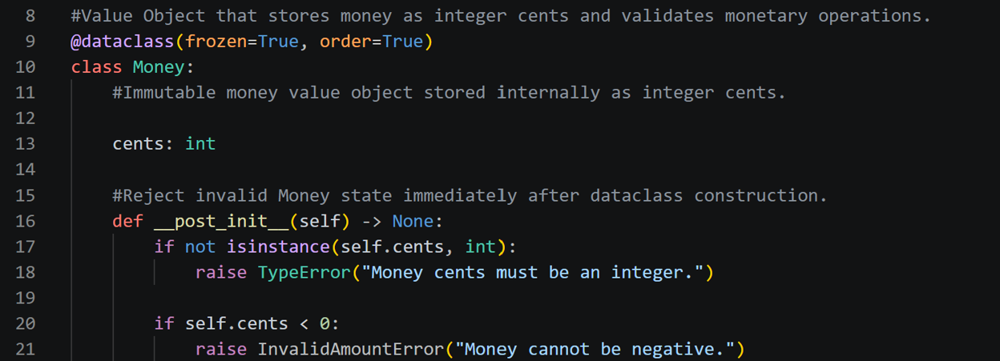

*Figure 1 Immutable Money class encapsulating monetary state and validation (banking/domain/money.py)*

***2-	Dependency Inversion Principle (SOLID) (Unit 2)***

Reason for use: Dependency Inversion was used so business services depend on repository abstractions rather than database specific implementations, reducing coupling and making dependencies easier to replace during testing.
 
 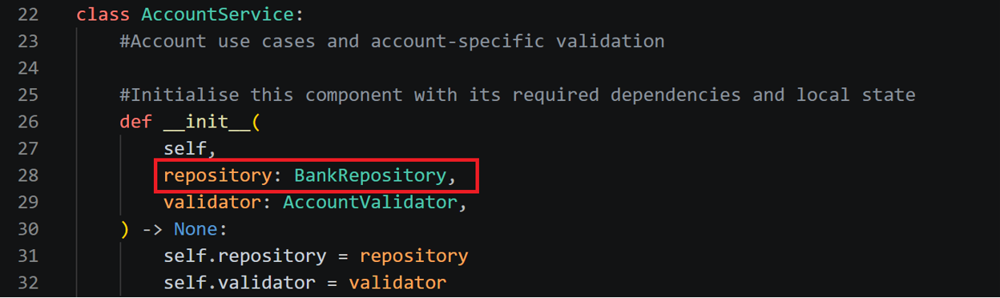

Figure 2 AccountService depending on the BankRepository abstraction rather than a concrete persistence implementation (banking/services/account_service.py)

***3-	Strategy Pattern (Unit 5)*** 

Reason for use: Strategy was used so fraud-assessment behaviour can be changed between local and simulated AI implementations without modifying the transfer workflow.
 
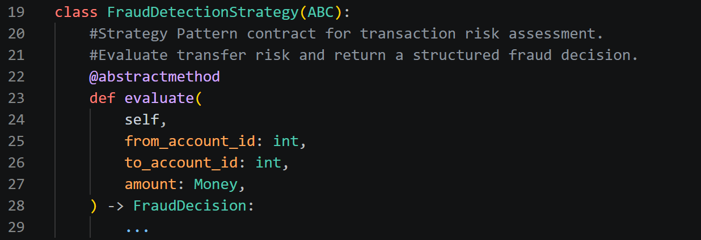

Figure 3 Strategy interface defining the evaluate() contract (banking/services/fraud.py)

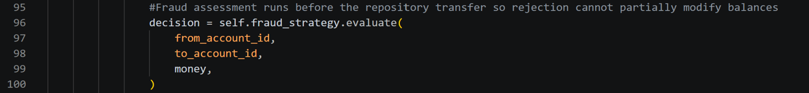

Figure 4 TransferService delegating fraud assessment to the configured strategy (banking/services/transfer_service.py)

***4-	Abstract Factory (Unit 3)*** 

Reason for use: Abstract Factory was used to create compatible fraud-assessment and risk-explanation service families while keeping provider-specific construction outside TransferService

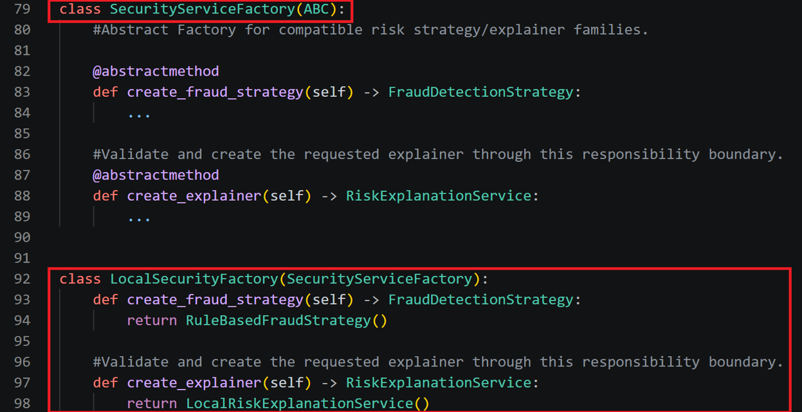

Figure 5 Abstract Factory contract and local security family (banking/services/fraud.py)

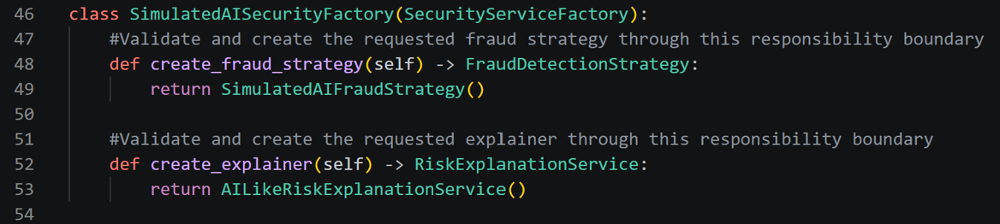 

Figure 6 Simulated AI security family (banking/services/ai_fraud.py)

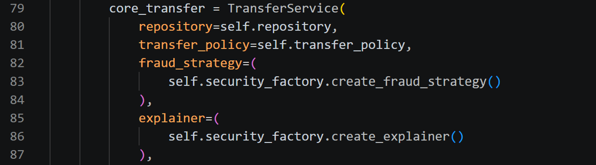 

Figure 7 Factory selected dependencies assembled in ApplicationContainer (banking/app/container.py)

***5-	Decorator Pattern (Unit 4)*** 

Reason for use: Decorator was used to add audit behaviour around transfer processing without modifying the core transfer workflow.

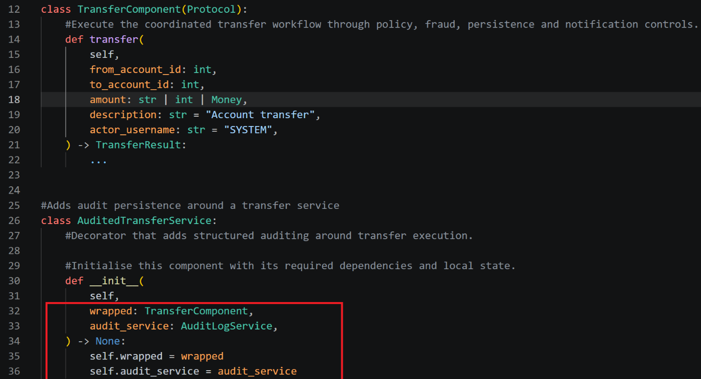 

Figure 8 AuditedTransferService wrapping the common transfer component while receiving a separate audit service (banking/patterns/decorators.py)

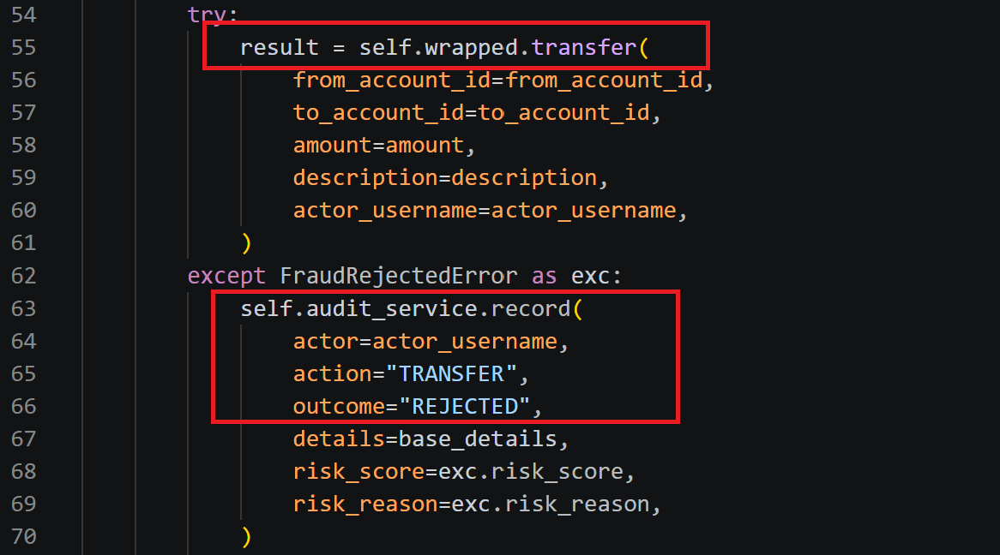 

Figure 9 Decorator delegating transfer execution to the wrapped component and adding audit recording for rejected transfers (banking/patterns/decorators.py)

***6-	Visitor Pattern (Unit 12)*** 

Reason for use: Visitor was used to keep account and transaction summary logic outside the Account and Transaction domain classes, avoiding unrelated reporting responsibilities inside the domain models.

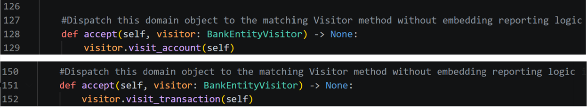 

Figure 10 Domain entities dispatching through accept() (banking/domain/models.py)

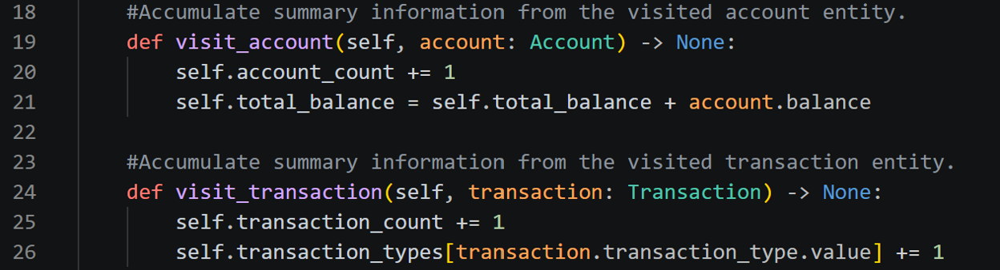 

Figure 11 PortfolioSummaryVisitor summary methods (banking/patterns/visitors.py)

***7-	Observer Pattern (Unit 5)*** 

Reason for use: Observer was used to keep customer notification behaviour separate from the transfer workflow, allowing transfer results to be delivered through different observer implementations without changing TransferService.

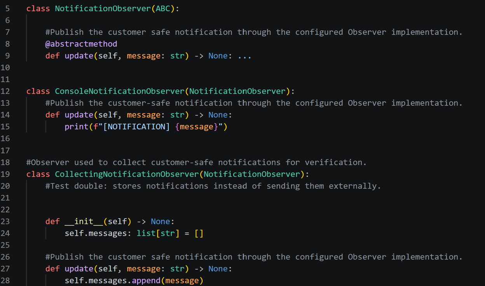 

Figure 12 Observer contract and notification implementations (banking/services/notifications.py)

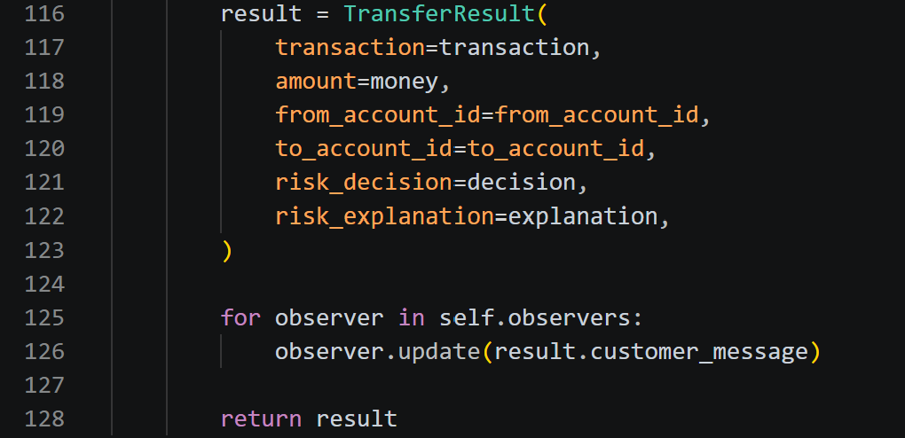 

Figure 13. TransferService notifying configured observers with the customer-safe transfer message (banking/services/transfer_service.py)

***8-	Concurrency & Deadlock Prevention (Unit 6)*** 

Reason for use: Account-specific re-entrant locks and consistent lock ordering were used to protect concurrent transfers and reduce the risk of deadlock when the same accounts are accessed from multiple threads.
 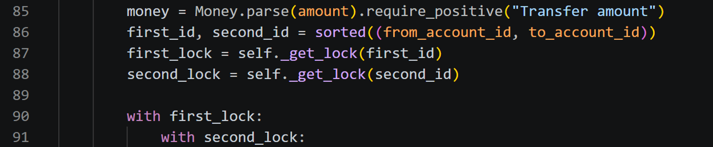

Figure 14. Deterministic account-lock ordering used to protect concurrent transfers and reduce deadlock risk (banking/services/transfer_service.py).

 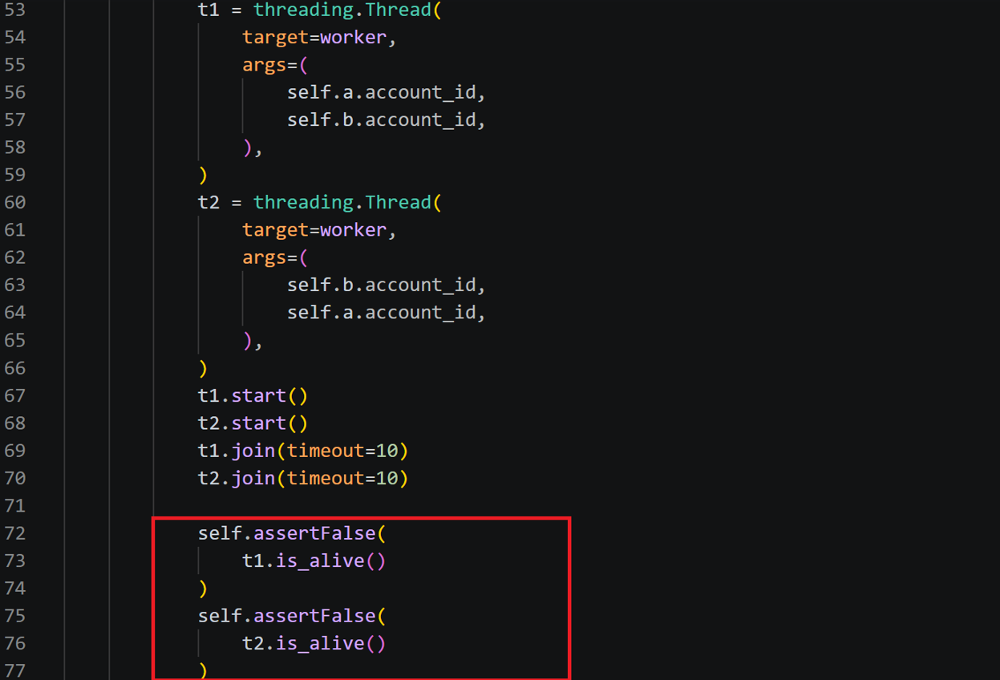

Figure 15 Opposite-direction concurrent transfer test verifying that both threads complete without deadlock (tests/test_concurrency.py).

***9-	Security Control (Unit 7)*** 

Reason for use: Password hashing was used to avoid storing plain-text passwords and to protect each password with an independent random salt before persistence.

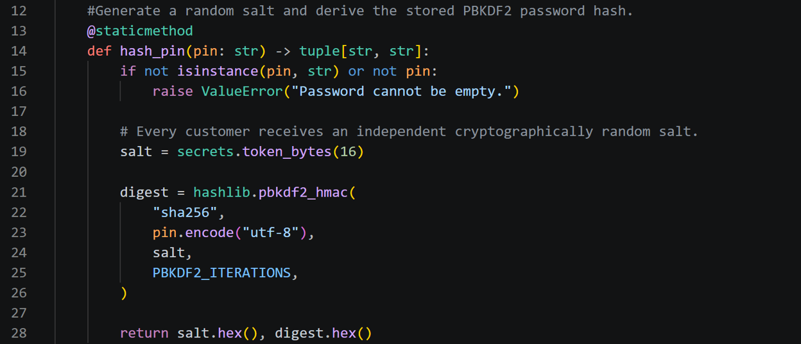

Figure 16 Password hashing using PBKDF2-HMAC-SHA256 with an independent random salt (banking/security/pin_hasher.py).

***10-	Refactoring and Maintainability (Unit 8)*** 

Reason for use: The daily transfer business rule was separated from the core transfer workflow to improve readability, maintainability and ease of change.

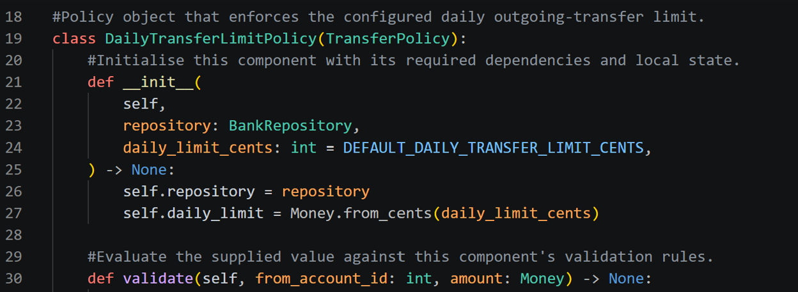

Figure 17 DailyTransferLimitPolicy separating the daily transfer business rule from the core transfer workflow (banking/services/transfer_policy.py)

***11-	Repository Pattern (Unit 9)*** 

Reason for use: Repository abstraction was used to keep persistence details separate from business services, allowing the application to depend on a common data-access contract rather than SQLite-specific code.

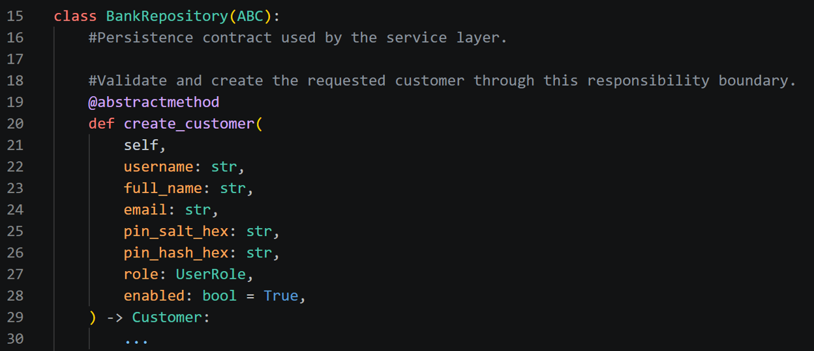

Figure 18 BankRepository defining the persistence contract used by the service layer (banking/repositories/interfaces.py)

***12-	Testing and Validation (Unit 10)***

Reason for use: Boundary tests were used to verify that transfer behaviour remains correct at and immediately above the configured fraud threshold.

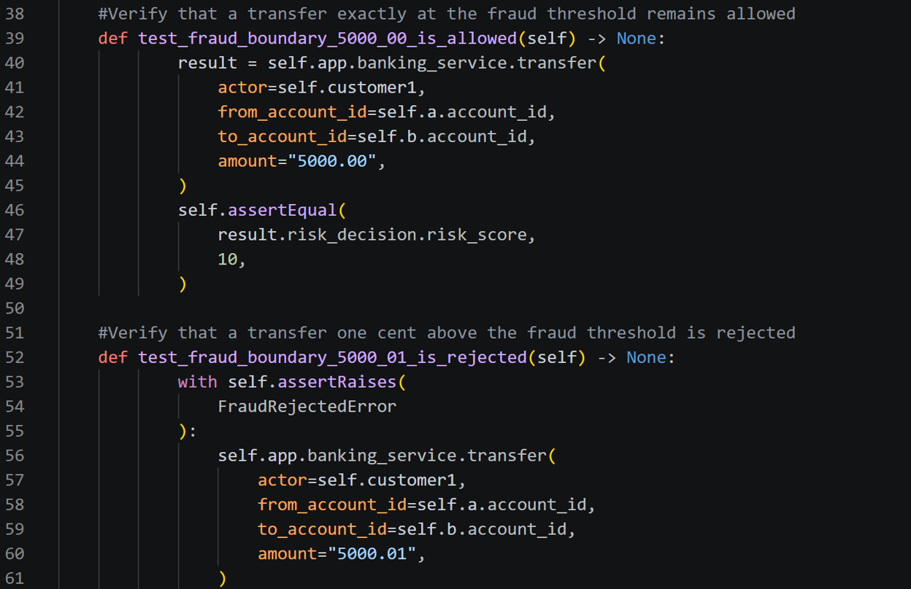

Figure 19. Boundary tests verifying allowed and rejected transfer behaviour around the fraud threshold (tests/test_transfer.py)

***13-	Dependency Injection & IoC (Unit 11)*** 

Reason for use: Dependency Injection was used to supply TransferService with its collaborators externally, reducing coupling and allowing dependencies to be replaced during testing.

Figure 20 TransferService receiving repository, policy, fraud, explanation and observer dependencies through constructor injection (banking/services/transfer_service.py)

***14-	AI Fraud Detection / AI-Readiness (Unit 12)***

Reason for use: The fraud subsystem was designed around replaceable abstractions so an AI-based fraud provider can be introduced without changing the core transfer workflow.

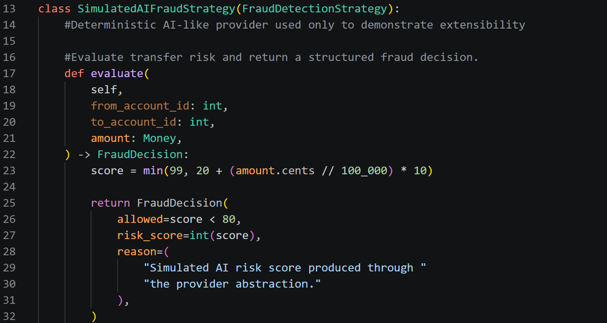

Figure 21 SimulatedAIFraudStrategy implementing the fraud-strategy abstraction as a deterministic AI-like provider (banking/services/ai_fraud.py).

## References

***Fowler, M. (2018) Refactoring:*** Improving the Design of Existing Code. 2nd edn. Boston, MA: Addison-Wesley Professional.

***Meszaros, G. (2007) xUnit Test Patterns:*** Refactoring Test Code. Boston, MA: Addison-Wesley.

***SQLite (n.d.) Appropriate Uses For SQLite.*** Available at: https://www.sqlite.org/whentouse.html (Accessed: 1 October 2026).

***Gamma, E., Helm, R., Johnson, R. and Vlissides, J. (1994) Design Patterns:*** Elements of Reusable Object-Oriented Software. Reading, MA: Addison-Wesley.